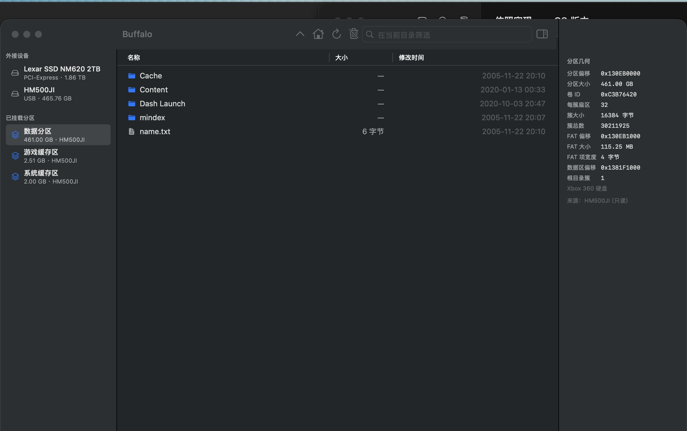

# BoxingBuffalo

macOS 上的 Xbox 360 硬盘工具。

## 这是什么

BoxingBuffalo 是一个 macOS 原生应用，用来浏览和读写 Xbox 360 硬盘的 FATX 分区。原版是 2012 年的 Windows 程序，本项目把它的 FATX 解析逻辑（CLKsFATXLib）重写成 Swift，界面用 AppKit 重做，并补上了原版没有的写入能力。

名字沿用原版 Party Buffalo 的词尾，前面的 Boxing 取自 Xbox 的 Box。既指认来源，也说明用途。



支持只读挂载、文件上传、新建目录、删除、重命名。所有写操作都经过确认对话框，失败会自动回滚 FAT 表与目录项。

## 下载

预编译版本见 [Releases](https://github.com/xurenfei/BoxingBuffalo/releases/latest)。程序未公证，ad-hoc 签名，首次打开请右键点击 `BoxingBuffalo.app` 选「打开」。

## 功能

- 扫描 USB 与内置磁盘，自动识别 FATX 分区与超级块
- 只读浏览，支持镜像文件（`.bin` / `.img`）与真盘两种来源
- 裸设备读写按 512 字节扇区对齐，规避 `EINVAL`
- 上传文件与整个文件夹，递归建目录，同名目录合并
- 写入按 8 MiB 窗口合并连续簇，实测 10.38 MB/s（旧路径 1.36 MB/s）
- 单次上传是原子的，取消后回滚本次全部 FAT 与目录项改动
- 附带 `fatxcheck` 命令行工具，用于镜像自检

## 构建

需要 macOS 13 及以上与 Swift 5.9 工具链。

```bash
swift build -c release
./scripts/build-app.sh
```

产物在 `dist/BoxingBuffalo.app`。脚本会自动用本机 `Apple Development` 证书签名，找不到则退回 ad-hoc。可用 `BOXINGBUFFALO_SIGN_IDENTITY` 指定其他身份。

镜像自检工具的用法如下。

```bash
.build/release/fatxcheck <镜像路径>
```

## 使用说明

完整操作步骤、写入前须知与性能分析见 [docs/upload-guide.md](docs/upload-guide.md)。

**写盘前请先做一件事。** 在根目录写一个 1 KB 的 txt，接回 360 用文件管理器确认能看见、能打开，再传大文件。真盘写入无法撤销，失败回滚只覆盖元数据，不覆盖已写入的数据区。

## 目录结构

```
.
├── Package.swift              SwiftPM 清单，三个 target
├── Sources/
│   ├── FatXCore/              FATX 解析与写入核心（无 UI 依赖）
│   ├── BoxingBuffalo/         AppKit 界面
│   └── fatxcheck/             命令行自检工具
├── Resources/
│   ├── AppIcon.png            图标源图 1024×1024
│   └── AppIcon.icns           构建脚本使用的图标
├── scripts/
│   ├── build-app.sh           编译并组装 .app
│   ├── reclaim-orphan-clusters.py   回收中断上传留下的孤儿簇
│   └── upload-progress.py     上传进度基准测试
├── docs/
│   ├── upload-guide.md        使用与排错指南
│   └── images/                截图
└── _local/                    本地私有资料，不入版本库
```

`_local/` 用于存放不随仓库分发的内容，包括原版 Windows 程序（用于行为比对）与真盘 FAT 备份。它已被 `.gitignore` 排除，仓库里不会出现。

## 技术要点

**扇区对齐读取。** macOS 裸设备只接受偏移和长度都是 512 字节倍数的传输。原版库用 `DownToNearest200` / `UpToNearest200` 手工对齐，本项目把这件事下沉到 `RawBlockSource.read`，上层调用不再关心对齐。

**写入合并。** 逐簇 16 KiB 读-改-写会被 USB 桥的往返延迟主导。`FatXWriter.addFile` 按 8 MiB 窗口把簇号连续的簇合并成一次 `pwrite`，4 KiB 对齐且整块覆盖时直通，跳过一次预读。

**事务回滚。** `WriteJournal` 在写入前快照将被修改的 FAT 扇区与目录项，出错或取消时写回原值。数据区不备份，最坏结果是泄漏一段簇。

## 已知限制

- FATX 文件名只支持 ASCII，最长 42 字节，中文名会被折叠成 `_`
- 单文件上限 4 GB（size 字段 32 位）
- 拖拽上传的手势尚未自动化验证
- `FatXVolume` 未标记 `Sendable`，并发闭包捕获时有编译警告

## 来源与许可

FATX 解析逻辑衍生自 CLKsFATXLib，该库随原版 Party Buffalo 一同发布。原项目以 GPL-3.0 授权，本项目作为衍生作品同样采用 [GPL-3.0](LICENSE)。

仓库不含原版 Windows 二进制与源码包。那些文件仅作本地比对参考，不随仓库分发。
